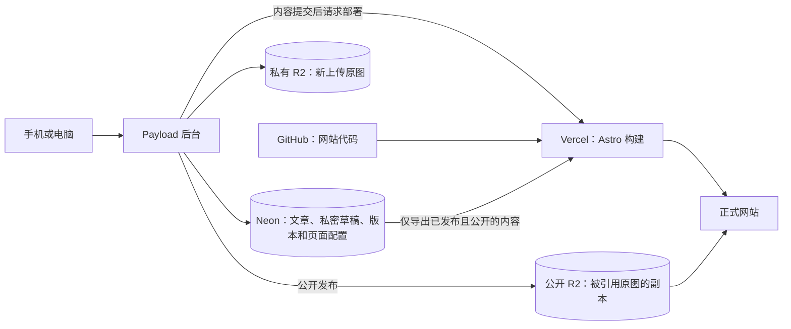

# Ricky 个人网站

当前正式站已切换到 **v2：Astro + Payload + Neon + R2**。v1 托管已暂停并断开 Git 自动部署，`v1.0.0` 标签、`release/v1` 与恢复资料继续保留。

- 网站：[www.heyrickishere.com](https://www.heyrickishere.com/)
- 内容后台：[网站的 /admin](https://www.heyrickishere.com/admin)，自动转到独立 Payload 后台
- 图片域名：`assets.heyrickishere.com`，沿用原图片完整地址
- 正式代码与自动部署分支：`main`；代码变更通过合并请求和检查进入主分支，保留分支保护

## 内容如何发布



在后台写作、保存草稿、预览并发布。博客、游记、研究日志，以及首页、关于、近况、项目、轨迹介绍和站点配置均由后台管理。发布或撤稿后，需要等待网站构建完成。

打开“后台管理 → 发布记录”可核对正式站的内容摘要。显示“已上线（内容已核验）”代表网站当前内容与这条发布记录一致；网络检查失败不表示构建失败。该核验不需要额外的 Vercel 管理密钥或付费监控。

历史版本可恢复。想先检查内容，请在文章版本菜单选择“恢复为草稿”；直接恢复已发布版本会更新发布内容。页面配置恢复历史版本也会恢复其发布状态。

## 内容和图片存在哪里

- 网站代码保存在 GitHub。正式构建显式设置 `CONTENT_SOURCE=payload`，从后台读取内容。
- 新草稿、私密文章和历史版本保存在 Neon，不随写作提交到 GitHub，也不进入前台导出。
- 新上传图片先存在私有 R2。公开发布时，仅复制文章引用的图片到公开素材桶，按文章类型和稳定素材编号归类。
- 新原图不压缩、不缩放。撤稿保留原图、历史版本及已经公开的图片副本。
- 旧 Markdown 和本地图片作为历史兼容资料保留；已公开的 Git 历史与图片不会因撤稿变成私密。

## 修改布局和代码

需要 Node `24.22.1` 或更高的 24.x 版本。前台代码在仓库根目录，独立 Payload 应用在 `cms/`。

```bash
npm ci --ignore-scripts
npm run dev
npm run check
npm run test:cms
npm run build
```

本机默认可用保留的历史内容调整布局。正式构建读取 CMS；需要本机连接云端内容时，按 [CMS 开发说明](cms/README.md) 单独配置受保护的只读连接。

修改代码后，通过合并请求和检查归并到受保护的 `main`，正式前台自动部署。内容编辑不需要改代码或向 GitHub 提交文章；后台发布连接同样使用 `main` 上的网站代码，从数据库读取本次公开内容并触发网站更新。初期隔离开发使用的 `feat/payload-v2` 不再是正式发布目标。

后台开发：

```bash
cd cms
npm ci --ignore-scripts
npm run dev
npm run check
npm test
```

后台配置见 `cms/.env.example`；数据库、会话、只读内容和 R2 凭据放在相应服务端环境，不进入仓库或前台产物。当前只开放唯一管理员，邮件密码恢复尚未配置。

## 备份与恢复

- [v1 基线和恢复说明](ops/v1-baseline.md)
- [v2 配置与边界](cms/README.md)
- [验证和上线记录](ops/v2-validation.md)

本机内容备份位于忽略版本控制的 `cms/private-exports/`，包含文章、草稿、可用版本、页面和媒体元数据；不包含账号、密钥、完整数据库或 R2 图片字节。原图和数据库须分别备份。

旧 PDF 测试入口 `/r2-pdf/` 保留说明页面。原测试文件当前不可用，`/api/r2-pdf` 转到说明页，不再调用旧存储接口；未删除任何存储对象。
