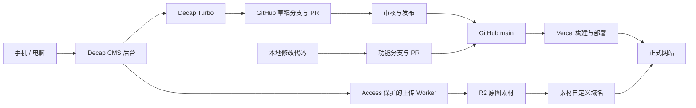

# Ricky Personal Site

> 当前正式站保持 **v1.0.0**（`release/v1`，`d5b026c`）。本分支 `feat/payload-v2` 正在开发 Payload＋Postgres 后台，尚未切换正式站。v1 恢复说明见 [固定版本说明](ops/v1-baseline.md)，v2 配置、验证与待办见 [v2 开发说明](cms/README.md)。

v2 将文章、草稿、版本和页面配置交给独立 CMS 管理，保留现有 Astro 页面与 R2 素材地址。前台缺省仍使用 v1 文件；只有显式设置 `CONTENT_SOURCE=payload` 才读取新后台。真实数据库与私有 R2 配置未完成前，不应切换该开关或停用 Decap。

一个基于 Astro 的中文个人网站，用来记录博客、研究日志、游记，以及长期项目和近况。日常内容通过线上后台编辑，布局和功能通过代码仓库维护。

- **正式网站**：[www.heyrickishere.com](https://www.heyrickishere.com/)
- **内容后台**：[www.heyrickishere.com/admin/](https://www.heyrickishere.com/admin/)
- **公开素材域名**：`https://assets.heyrickishere.com`

## 当前架构

| 组件 | 用途 |
| --- | --- |
| Astro、TypeScript、Markdown / JSON | 页面、样式、文章和页面文案 |
| Decap CMS | 线上编辑、草稿、预览、审核与发布界面 |
| Decap Turbo | 后台登录、GitHub 连接和内容工作流所需的访问 |
| GitHub | 保存代码、文字、配置、草稿分支和版本记录 |
| Vercel | 根据 GitHub 提交构建，提供预览部署与正式网站 |
| Cloudflare Worker + Access | 保护图片上传与素材列表入口 |
| Cloudflare R2 | 保存原图，通过独立素材域名提供图片 |



当前公开站以静态页面为主。文字和页面配置保存在仓库，图片保存在 R2；日常发布不需要维护 VPS 或常驻数据库。

## 日常写作与页面管理

打开[正式后台](https://www.heyrickishere.com/admin/)并登录。后台目前包含：

| 入口 | 可编辑内容 |
| --- | --- |
| 博客 | 标题、简介、日期、标签、可选封面、Markdown 正文 |
| 游记 | 标题、简介、日期、封面、Markdown 正文 |
| 研究日志 | 标题、摘要、日期、项目、进展状态、资料链接、Markdown 正文 |
| 页面与站点 → 首页 | 开场文案、区块内容、显示开关和列表排序 |
| 页面与站点 → 轨迹 | Citywalk 与出行路线页面的介绍和空状态文案 |
| 页面与站点 → 关于我 | 自我介绍、个人信息和链接 |
| 页面与站点 → 最近在做什么 | 页头与近况记录 |
| 页面与站点 → 长期项目 | 页头与项目列表 |
| 页面与站点 → 站点简介 | 站点描述、个人简介、联系信息和社交链接 |

1. 新建或打开内容，编辑文字，上传或复用 R2 图片。
2. 点击「保存」，等待「修改已保存」。换设备前先确认保存成功。
3. 在「工作流」中继续编辑草稿、审核，并检查预览。
4. 点击「发布」。内容合入 `main` 后，等待 Vercel 的正式部署成功，再打开正式页面核对。

保存会写入对应的 `cms/blog/*`、`cms/travel/*`、`cms/research/*` 或 `cms/pages/*` 分支，并创建面向 `main` 的 PR。**后台的“已发布”表示仓库已合并，网站更新还要等待部署完成。** 构建失败时，上一版正式部署继续提供服务，已提交内容仍保存在 GitHub，可修正后重新发布或部署。

右侧预览用于边写边看；构建预览用于核对实际网站。首页自动文章列表在编辑器里以说明卡片表示，完整聚合效果以构建预览为准。左下角「外观」支持跟随系统、浅色、深色，预览同步切换；右下角有「写作帮助」。

本机恢复备份只属于当前浏览器，不能代替成功保存到 GitHub。两台设备编辑同一篇内容时，先保存一台，再重新打开另一台；当前没有双设备并发防覆盖保证。

## 图片与素材复用

图片从后台的素材入口进入受 Cloudflare Access 保护的 Worker，写入 `ricky-site-media` 桶。Markdown 和封面保存可访问的素材地址，正式网页从素材域名读取图片。

- 支持 JPG、PNG、WebP、GIF、AVIF，单张上限 15 MB。
- 保存原文件，不进行压缩或降质；原图元数据也会保留。
- 新素材按 `cms/<文章类型>/<media_id>/` 归类，文件名由上传服务生成。目录使用稳定编号，修改文章标题不会移动图片。
- 素材列表可复用当前文章目录及早期 `cms/` 平铺目录中的已有图片，兼容 `cms/<图片编号>.<扩展名>` 地址。
- `media_id` 由后台自动生成并保持不变。新文章优先用「新建」；原生「复制」会沿用原文章的素材编号。
- 图片上传后仍需保存文章。删除素材前要检查已发布文章和草稿的引用。

正文使用标准 Markdown 图片语法。连续、各自单独成段的图片会在正式详情页增强为图组，支持点击放大。

## 修改布局与功能

页面结构、样式、交互和构建逻辑通过本地代码维护：

```text
同步 main → 创建功能分支 → 本地修改与检查 → 推送 GitHub
→ 创建 PR → 检查 Vercel 预览 → 合并 main → 等待正式部署
```

Vercel 继续通过 GitHub 集成部署，构建命令为 `npm run build`，输出目录为 `dist/`。内容发布与代码开发都经过 PR；主分支要求通过 `CMS content changes` 检查。该检查限制 CMS 分支只能更新对应文章或固定页面 JSON，普通功能 PR 仍可修改程序代码。

修改网站布局、文章模板或样式通常只需部署 Vercel 网站。只有修改图片上传、格式验证、素材列表、R2 绑定或上传权限时，才需要单独更新 Worker。详细设置见 [正式后台运维说明](ops/cms-production.md)。

## 本地开发

建议使用与 CI 一致的 Node.js 24，并从仓库根目录运行：

```bash
npm ci
npm run dev
```

本地开发主要用于网站页面和代码。线上后台的登录来源限定为正式后台地址；本地启动 Astro 不会自动获得线上后台权限。

站点域名默认值位于 `src/data/site.ts`；需要调整构建域名时可通过 `SITE_URL` 配置。它不开放给内容后台修改。

| 命令 | 用途 |
| --- | --- |
| `npm run dev` | 本地开发 |
| `npm run check` | Astro / TypeScript 检查 |
| `npm run test:cms` | 后台配置、预览、主题、数据校验和发布边界检查 |
| `npm run build` | 生成静态网站 |
| `npm run preview` | 本地查看构建结果 |
| `npm run new:post -- my-post` | 从模板创建博客文件 |
| `npm run new:research -- weekly-update` | 从模板创建研究记录 |
| `npm run new:travel -- my-trip` | 从模板创建游记 |

新建脚本会生成带当天日期的文件名，并复制模板；请自行核对 frontmatter 的日期、标题、封面和正文。

## 内容与目录

```text
src/content/blog/             博客 Markdown
src/content/research/         研究日志 Markdown
src/content/travel/           游记 Markdown
src/content.config.ts        文章字段与构建校验
src/data/homepage.json        首页区块与文案
src/data/tracks.json          轨迹页文案
src/data/about.json           关于页
src/data/now.json             近况
src/data/projects.json        项目
src/data/site.json            站点文案与联系信息
src/components/               公共组件
src/layouts/                  页面与文章布局
src/styles/                   网站样式
src/lib/page-data.mjs         页面保存与构建共用的校验器
public/admin/                 正式后台入口、配置、主题和页面预览
public/cms-trial/             共用的编辑器、R2 适配与发布检查模块
ops/r2-media-worker.mjs       图片上传与素材列表 Worker
ops/cms-production.md         正式后台配置、验收与回退说明
templates/                    本地新建文章模板
scripts/                      内容脚本与自动检查
.github/workflows/            CMS 编辑器检查与发布范围保护
```

博客与游记使用 `description`，研究日志使用 `summary`。三类文章都有 `title`、`date`；`draft: true` 会让文章从正式构建中隐藏，`media_id` 为可选 UUID。博客支持 `tags` 和可选 `cover`，游记要求 `cover`，研究日志支持可选的 `project`、`status` 和 `links`。资料链接仅支持 HTTP / HTTPS。具体示例见 [文章模板](templates/) 与 [内容结构](src/content.config.ts)。

线上工作流草稿由分支和 PR 状态管理，通常保留 `draft: false`，以便合并后正常展示。首页区块按 JSON 数组顺序显示，旧 `order` 字段保留兼容；区块 `id` 应保持稳定。

## 访问、凭据与费用

仓库和素材域名公开，草稿分支、草稿中的文字以及已上传图片都应按公开资料处理。上传器和素材列表受 Access 保护；图片公开读取不需要后台登录。

GitHub 访问通过已配置的 Turbo 连接完成；图片服务使用 Worker 的 R2 绑定。不要把 GitHub、Cloudflare 或 Vercel 的凭据提交到仓库，也不要放进前端代码。

项目以个人使用、轻量维护为目标。实际费用取决于各账号套餐、存储与请求用量，另外还有域名续费；仓库本身不保证始终免费。额度和账单以 Vercel、Cloudflare、Decap Turbo 的账号面板为准。

## 历史文件与回退

仓库仍保留旧 VPS 方案的 `admin/`、`ops/nginx-site.conf`、`ops/ricky-admin.service` 和相关脚本。`npm run deploy`、`npm run admin:start`、`npm run admin:set-password` 属于这套旧流程，**不用于当前 Vercel 正式发布**。旧试用入口会跳转正式后台，`public/cms-trial/` 中部分模块仍由正式后台复用。

站点代码需要回退时，通过 PR 撤销对应改动并重新部署，使 GitHub 与正式站保持一致。代码回退不会删除或恢复 R2 图片；素材应独立管理。更多操作见 [正式后台运维说明](ops/cms-production.md)。
