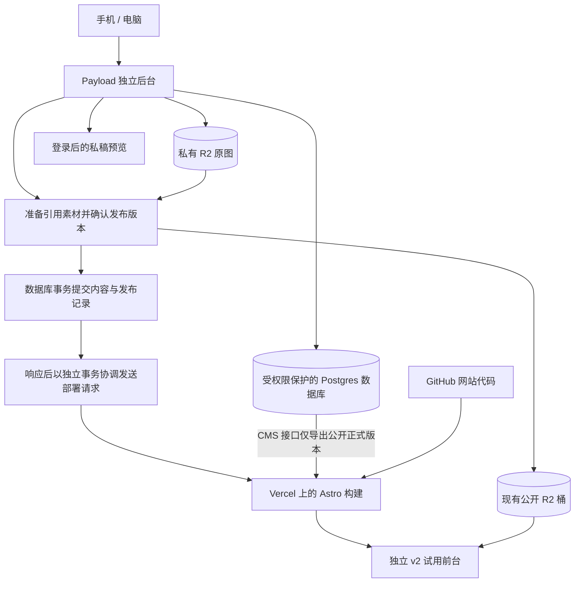

# Ricky 内容后台 v2

本目录是独立的 Payload 应用。生产网站仍运行 v1，当前代码没有替换正式域名或停用 Decap。

## 已准备的能力

- 原生 Lexical 富文本编辑器，含图片、表格和代码块；博客、游记、研究日志共用文章管理。
- 云端草稿、自动保存、版本记录，以及“公开展示 / 仅自己”的可见范围。
- 首页区块、关于、近况、项目、轨迹介绍与站点配置。
- 唯一管理员的邮箱、密码登录与会话认证；关闭公开注册，包含 Payload 首次用户注册的特殊路径。本版尚未实现 GitHub OAuth。
- 私有素材上传、发布时复制被引用原图、15 MB 限制、文件签名检查。已完成线上新图上传、刷新预览、用户发布，以及公开副本的封面和正文展示验证。已导入的旧图片可以复用，没有图像压缩或缩放转换；原始与公开对象的完整哈希对比尚未完成。
- 登录后打开已保存稿件预览；该预览为 v2 阅读样式，尚未完成与 Astro 正式模板的逐像素验收。
- 只读正式内容接口 `/api/site-content`，以及 Astro 构建读取适配。
- 与内容一起持久化的发布记录、提交后的部署请求与手动重试。“已请求部署”不表示“已上线”。
- 从冻结的 v1 Git 对象离线预检及幂等导入；私有内容与版本导出。

## 当前外部连接状态

| 项目 | 状态 |
| --- | --- |
| v1 Git 标签和恢复归档 | 已创建、校验；生产为 `d5b026c` |
| Vercel `ricky-cms-v2` | 已创建独立项目；根目录 `cms`，Next.js，Node 24 |
| Neon `ricky-cms-v2-db` | 已创建并连接独立项目，核对为 `free_v3` 免费方案 |
| 私有 R2 桶和凭据 | Production 已配置并完成用户新图上传验证；Preview / Development 尚未配置，相关环境新上传关闭 |
| 数据库迁移、管理员初始化、真实文章导入 | 已完成；6 篇正式文章、6 组页面、3 个旧素材引用 |
| Payload 后台部署 | 修正版 `8dffb64` 的 `dpl_DXm4h2aL1ptHr5eQHQTbWUdrvxsD` 已 `READY` 并提升到固定地址 `ricky-cms-v2.vercel.app` |
| 线上用户验证 | 登录、新图上传刷新及原生 UI 发布成功；公开图片 `200`、大小与素材记录一致，私有原始接口仍拒绝匿名读取 `403` |
| 浏览器界面与独立手机会话 | Playwright 与隔离 Chrome 经保留后台来源的本机生产构建转发验证：输入、自动保存刷新、手机续稿、深浅色和完整私稿预览通过 |
| 本机生产构建 HTTP 验收 | 登录、会话 Cookie、旧图及私稿预览、草稿续写、CSRF 与公开接口共 16 项通过 |
| Astro 内容源与保护读取 | 独立 `ricky-site-v2` 云端构建已 `READY`；用户授权的唯一项目 Production→CMS Production 规则已配置，使用 OIDC 与专用只读凭据 |
| 发布钩子 | 仅作用于 v2 前台的钩子已配置；原生 UI 再次发布后自动构建成功，线上页面已验证新文字与新图 |
| 检查与派发回归 | CMS 80 项、Astro 347 项通过；真实 Neon 中的派发并发与模拟失败恢复共 13 个布尔断言通过 |
| 真实数据库验证与内容导出 | 23 项受控检查通过；已导出并核验 8 份内容 JSON 与校验清单的权限、校验和 |
| 邮件与密码恢复 | 关闭；尚未连接邮件服务 |
| 正式域名、Decap、上传 Worker | 继续服务 v1 |

Neon 已核对采用 `free_v3` 免费方案；认证由 Payload 提供，本版不依赖额外 Neon Auth 和 Realtime。免费额度以平台当前套餐为准。

这里的 Production / Preview / Development 指对应独立 Vercel 项目的环境。新 CMS 和新前台各自的 Production 不代表个人站正式域名已经切换到 v2。

试用后台入口为 [`ricky-cms-v2.vercel.app/admin`](https://ricky-cms-v2.vercel.app/admin)，保留 Vercel 访问保护，没有接管个人站域名。用户已在实际线上环境确认登录和新图上传；连接器读取登录页为 `200`，匿名请求新图的原生文件接口为 `403`。自动浏览器验证采用本机生产构建转发，保留正式后台来源并使用真实 v2 数据库，不能称为公网部署的全自动端到端验收。登录资料不进入仓库。

独立 v2 前台为 [`ricky-site-v2.vercel.app`](https://ricky-site-v2.vercel.app/)，仍有 Vercel 访问保护。`8dffb64` 经 Git 推送触发的生产部署 `dpl_2EnGjWTzz78RCLXnLoQugT2FvQVG` 已 `READY`；线上首页和测试游记均为 `200`，游记含新图的公开封面与正文链接，没有私有 R2 或后台文件接口链接。网站源码仍由 GitHub 管理，文章正文来自 CMS 数据库。随后用户再次在原生 UI 发布测试稿，发布记录保存部署请求编号，自动触发 `dpl_EZ9REZzSnb7EDpnLAvL1hG7Xhbp6` 并 `READY`；固定前台地址已验证出现该次新文字及同一公开图片。后台仍只显示请求接收状态，不把此次人工验收描述成已实现自动匹配最终部署版本。测试文章暂保留供查看。

## 结构

下图展示 v2 目标链路。数据库、私有原图、发布后的公开副本、独立云端前台及后台发布触发构建均已验证。原正式域名继续服务 v1。



## 连接和启动顺序

1. 将本目录所属代码连接到独立 Vercel 项目，确认没有使用 v1 项目或正式站部署钩子。
2. 通过 Vercel Marketplace 创建并连接真实 Neon 免费数据库，然后拉取环境变量。不要用占位数据库地址启动或迁移。
3. 按 `.env.example` 在本地私有 `.env.local` 中补齐变量。凭据不进入 Git，不在聊天或构建日志中打印。
4. 生成数据库迁移，检查生成 SQL，仅在新的 v2 数据库中执行；本项目关闭自动 schema push。
5. 通过 `owner:init` 初始化唯一管理员。`CMS_ADMIN_PASSWORD` 只用于本机初始化，不写入 Vercel 环境。
6. 先运行 v1 导入离线预检，再执行 `--apply`。已有文章、页面保持原样，不覆盖后续编辑。
7. CMS Production 的私有 R2 已配置；新图上传、刷新预览、发布及公开副本已验证。Preview / Development 的私有上传配置仍不齐全，如需启用须另行配置对应环境的桶、限定权限和 CORS；缺少配置时该环境上传关闭，没有本机临时存储回退。
8. 独立前台 `ricky-site-v2` 已连接同一仓库，生产分支由用户保存为 `feat/payload-v2`，并从 CMS 读取公开内容完成云端构建。只作用于该前台的发布钩子已通过实际发布联动；正式切换前保留 v1。

需要 Node `^24.22.1`。从本目录运行：

```bash
npm ci --ignore-scripts
npm run generate:types
npm run generate:importmap
npm run check
npm test
npm run import:v1 -- --dry-run
```

只有真实环境连接并验证后，才运行：

```bash
npm run db:generate
npm run db:migrate
npm run owner:init
npm run import:v1 -- --apply
npm run dev
```

`db:generate` 生成的 `src/migrations/` 文件须检查并提交；类型生成和 import map 生成不连接数据库。实际 Payload 初始化会先检查数据库地址、密钥、管理员邮箱与 HTTPS 来源。

当前 CMS 的 80 项测试与 Astro 的 347 项测试通过。上游依赖仍可能显示 `cache-dir` 或弃用警告；这些提示不表示必须购买 Pro，仍需根据实际构建、检查和功能验证结果处理。

这里使用 Payload 自带的密码登录，不沿用 v1 Decap 的 GitHub 登录，也没有实现早期方案中的 GitHub OAuth。`owner:init` 只创建 `CMS_ADMIN_EMAIL` 指定的唯一管理员；已有管理员时拒绝重复初始化。生产环境使用安全会话 Cookie，登录失败 5 次后锁定 15 分钟，会话有效期为 2 小时。线上登录已获用户确认；本机生产 HTTP 与受控浏览器已验证真实数据库会话及 `Secure / HttpOnly` Cookie。独立手机会话续稿通过，并发编辑与浏览器版本恢复仍待验收。

目前不连接邮件服务；密码恢复邮件会明确失败，避免 Payload 的开发回退适配器把恢复链接写入日志。已登录后可以修改自己的密码。

## 关键配置

| 变量 | 用途 |
| --- | --- |
| `DATABASE_URL` | 新 v2 Postgres 数据库连接；不要在日志中显示 |
| `PAYLOAD_SECRET` | 至少 40 字符的独立高熵会话密钥 |
| `CMS_URL` | 当前后台的实际 HTTPS 地址；仅本地开发允许 localhost HTTP |
| `CMS_READ_TOKEN` | 至少 40 字符的独立只读内容凭据，只放服务端 |
| `CMS_ADMIN_EMAIL` | 唯一管理员身份 |
| `CMS_ADMIN_PASSWORD` | 本机初始化专用，至少 16 字符；不部署 |
| `R2_*` | 私有上传桶、现有公开桶和限定桶权限凭据；私有上传凭据目前仅 Vercel Production 齐全，见 `.env.example` |
| `SITE_DEPLOY_HOOK` | 仅指向独立 `ricky-site-v2 / feat/payload-v2` 的部署钩子，CMS Production 中为 sensitive；钩子 URL 不进入仓库或本机文件 |

独立 Astro 项目的 Production 设置 `CONTENT_SOURCE=payload`、`CMS_URL`、`CMS_READ_TOKEN`。专用只读凭据已获用户明确授权复制到前台的敏感环境变量；不复制数据库地址、Payload 会话密钥、管理员密码或 R2 写入密钥。云端构建附加短时 `VERCEL_OIDC_TOKEN`，通过 CMS 上仅允许该项目前台 Production→CMS Production 的 Trusted Sources 规则，同时保留应用层 Bearer 校验及双方的 Vercel 访问保护。读取器只向配置的 HTTPS `*.vercel.app` 目标发送该平台令牌，不发送给本机、自定义 CMS 或相似域名，不跟随重定向。读取出错、草稿混入、页面缺失、私有签名图片地址都会中止构建，不回退到仓库文章。

## 素材与发布边界

- 已导入的 3 个旧素材引用保留原公开地址，可以用于封面或正文；这不代表已扫描或迁移整个 R2 桶。旧图片复用不需要重新上传。
- 新上传原图先保存在私有桶，未公开发布的新图没有 `publicUrl` 属于预期状态。本次新图经用户在原生 UI 发布后，封面和正文引用同一个公开副本，路径按 `cms/travel/<media_id>/` 归类。公开 GET 为 `200`，JPEG 签名及 `13,738,798` 字节大小与素材记录一致；尚未完成原始对象与公开副本的完整哈希对比。私有原始文件接口仍拒绝匿名读取 `403`。私有素材具体名称不写入公开文档。
- 私有桶不能开启公共域名或 `r2.dev`。公开桶继续使用 `assets.heyrickishere.com`。
- R2 CORS 来源必须限定到实际 CMS 地址，允许原生直传需要的 `PUT`、`Content-Type`、`If-None-Match`；后台预览读取通过鉴权后签发 5 分钟读取地址。
- 发布前检查原对象大小、格式签名，再按 `cms/<文章类型>/<media_id>/` 复制原始字节。对象路径包含稳定指纹，重试不会覆盖原已发布文件。
- 当前实现禁止通过后台永久删除文章和素材，也不允许替换已有素材的原图。需要新图片时上传一份新素材，再替换文章引用；需要隐藏文章时使用撤稿或“仅自己”，并等待网站部署完成。
- 修改已发布文章时，新草稿继续保留原正式版本。已在真实数据库用独立请求验证；桌面自动保存刷新与独立手机会话续稿已通过受控浏览器验证，并发设备编辑仍待验收。
- 首页、关于、近况、项目、轨迹与站点配置是 6 个必备页面。已有正式版本时不允许撤稿，以免构建缺少页面；仍可保存新草稿而保留正式版本。首页局部内容通过“显示这一块”隐藏，再发布该页面。
- 私有内容的权限不会收回曾公开的图片、Git 历史、旧部署或他人副本。
- 发布数据库事务与 R2 复制不是跨平台原子事务；复制后数据库写入失败时可能留下未被引用的公开副本，后续清理需核对引用。

## 保存、发布和网站更新

独立云端 Astro 前台及受保护的跨项目读取已连通，新图发布到公开桶和前台展示已验证。`SITE_DEPLOY_HOOK` 已按用户明确授权创建并配置到 CMS Production；后台更新后，原生 UI 发布触发前台构建并已验证线上新文字。后台保存草稿写入数据库，公开发布准备引用素材并保存发布记录；这些操作不更新正式 v1 网站。

保存草稿只写入 v2 数据库。发布公开文章、更新必备页面，或撤下原先公开的文章时，内容变更与对应发布记录写入同一个数据库事务；发布记录写入失败会使该次内容事务失败，避免已保存发布却丢失部署事件。同一事件重复执行时复用已有记录。

内容事务提交并结束请求后，由 Next.js 的 `after` 回调读取已提交的发布记录，再通过独立请求调用 Vercel 部署钩子，不沿用内容请求的数据库事务。回滚后不存在的记录不会触发部署。未配置钩子时保留“等待配置预览部署”；回调无法调度时保留待处理记录，不能视为请求已经发出。

Vercel 接收钩子后，记录显示“已请求部署”，此时还需要构建成功。部署请求失败或结果未确认时，数据库里的内容和发布记录继续保留；管理员可以进入该记录手动重试。重试需要有效登录及来源校验。当前没有自动核对部署最终结果，需在 Vercel 和网站预览中确认，不能把记录状态当作“已上线”。

派发器已在真实 Neon 中做受控验证：仅使用两条自建测试记录和三次模拟 HTTP 返回，验证已接收的记录不重发、并发请求只有一个进行中派发，以及模拟 `503` 后重试 `200` 恢复，共 13 个布尔断言通过。测试后只清理这两条记录。这验证了数据库中的派发协调与失败记录恢复，不等于真实 Vercel 远端构建失败后恢复的验收。

## 导入与备份

导入器固定读取 `v1.0.0` 对应的 `d5b026c7ca5029ca006a4b12de2667c57b8b8ffd`，只处理其中的 6 篇文章和 6 份页面配置。不读取当前工作树草稿，不通过 HTTP 接受导入目录。默认运行或显式 `--dry-run` 完成正文语义、图片、链接、代码、表格和页面配置往返预检，不连接数据库。执行环境必须包含该 Git 标签及所需历史；CI 应使用完整检出。`--apply` 才连接新 v2 数据库，复用可信旧图片地址，不重复上传或压缩图片，且不触发网站部署。重复导入会跳过已有内容，不覆盖之后的编辑；导入不是一次全量事务，部分完成后可以修正并重试。

```bash
npm run export:backup
```

内容导出须连接真实 v2 数据库并验证已配置的管理员，保存到忽略版本控制的 `private-exports/`（目录 700、文件 600），包含正文、草稿、可用版本、页面、媒体元数据和发布记录，并生成文件校验清单。导出排除用户记录、密码哈希、会话与配置密钥。它不是 `pg_dump` 全库备份，JSON 中也不包含 R2 图片二进制；数据库与 R2 原图须独立备份。导出时暂停编辑，以避免非事务分页读取期间内容变化。已对真实 v2 数据库完成一次导出，8 份内容 JSON 与清单共 10 个文件，校验和及目录 700 / 文件 600 权限检查通过。

```bash
npm run verify:live -- --run
```

此受控验证仅针对新的 v2 数据库，默认不运行。显式 `--run` 会创建一篇随机地址的临时文章，验证草稿跨请求保存、正式版本隔离、历史版本、公开接口合同、撤稿、私密可见性与匿名权限，然后清理该文章及版本。过程中临时文章会短暂进入受保护的只读接口，但不会触发部署；运行时暂停编辑与预览构建。23 项真实检查已通过，公开内容恢复为原 6 篇，未产生部署记录。它不能替代浏览器、并发设备或 R2 测试。

受控命令在所有操作与 `payload.destroy()` 完成并排空输出后显式退出，与 Payload 自带 CLI 保持相同做法，避免上游适配器残留的连接令命令不结束。应用使用 5 个连接上限和 15 秒连接等待上限，以容纳并发编辑与原生锁检查；Neon 连接显式使用完整 TLS 证书校验。

## 验收尚未完成的部分

- 公网部署的全自动端到端验证。线上用户登录、新图上传刷新、匿名新图读取拒绝已分别确认；本机生产构建转发中的浏览器验证有明确范围。
- 两个设备并发编辑冲突和浏览器中的版本恢复；桌面自动保存刷新与独立 `390×844` 手机浅色会话续稿已通过。
- 原始对象与公开副本的完整哈希对比，以及素材复制或远端构建失败后的实际恢复；新图 UI 发布、公开副本、封面和正文展示已分别通过。
- 撤稿与页面更新后的实际部署，以及真实远端构建失败后的恢复。文章发布的钩子联动、受保护的跨项目读取和模拟请求失败恢复已分别通过。
- 部署状态精确匹配发布版本。目前只有部署请求记录，不宣称已经查到本篇文章“已上线”。
- 更多实际手机与浏览器的视觉检查。受控桌面深浅色与 `390×844` 手机浅色会话、原生富文本、完整私稿预览及旧封面实际加载已验证。
