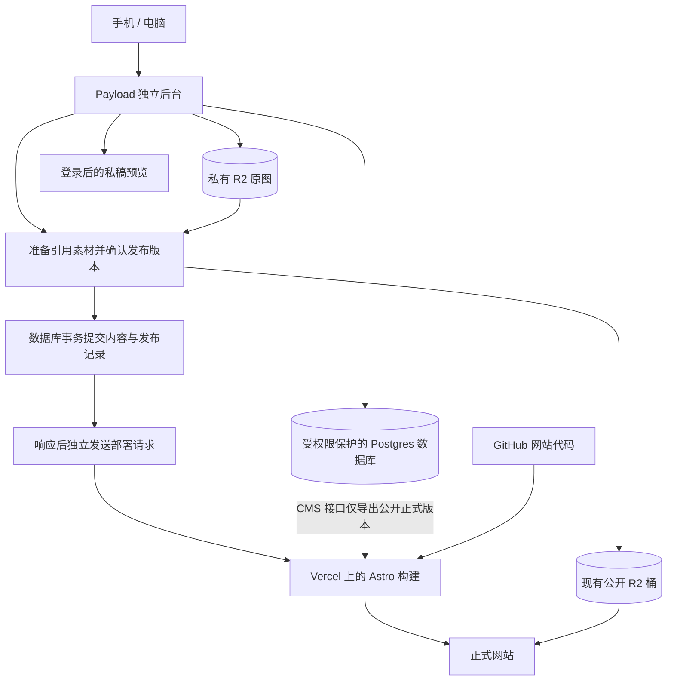

# Ricky 内容后台 v2

本目录是独立的 Payload 应用。生产网站仍运行 v1，当前代码没有替换正式域名或停用 Decap。

## 已准备的能力

- 原生 Lexical 富文本编辑器，含图片、表格和代码块；博客、游记、研究日志共用文章管理。
- 云端草稿、自动保存、版本记录，以及“公开展示 / 仅自己”的可见范围。
- 首页区块、关于、近况、项目、轨迹介绍与站点配置。
- 唯一管理员的邮箱、密码登录与会话认证；关闭公开注册，包含 Payload 首次用户注册的特殊路径。本版尚未实现 GitHub OAuth。
- 私有素材上传连接、发布时复制被引用原图、15 MB 限制、文件签名检查。没有图像压缩或缩放转换。
- 登录后打开已保存稿件预览；该预览为 v2 阅读样式，尚未完成与 Astro 正式模板的逐像素验收。
- 只读正式内容接口 `/api/site-content`，以及 Astro 构建读取适配。
- 与内容一起持久化的发布记录、提交后的部署请求与手动重试。“已请求部署”不表示“已上线”。
- 从冻结的 v1 Git 对象离线预检及幂等导入；私有内容与版本导出。

## 当前外部连接状态

| 项目 | 状态 |
| --- | --- |
| v1 Git 标签和恢复归档 | 已创建、校验；生产为 `d5b026c` |
| Vercel `ricky-cms-v2` | 已创建独立项目；根目录 `cms`，Next.js，Node 24 |
| Neon `ricky-cms-v2-db` | 等待账号本人确认 Marketplace 条款，尚未创建 |
| 新私有 R2 桶和凭据 | 待配置；现有凭据只覆盖旧桶 |
| 数据库迁移、管理员初始化、真实文章导入 | 未执行 |
| Payload 后台部署与浏览器验收 | 未完成 |
| 正式域名、Decap、上传 Worker | 继续服务 v1 |

Neon 计划选用 `free_v3`、`iad1`，关闭额外 Neon Auth 和 Realtime；认证由 Payload 提供。免费额度以平台当前套餐为准。

## 结构



## 连接和启动顺序

1. 将本目录所属代码连接到独立 Vercel 项目，确认没有使用 v1 项目或正式站部署钩子。
2. 通过 Vercel Marketplace 创建并连接真实 Neon 免费数据库，然后拉取环境变量。不要用占位数据库地址启动或迁移。
3. 按 `.env.example` 在本地私有 `.env.local` 中补齐变量。凭据不进入 Git，不在聊天或构建日志中打印。
4. 生成数据库迁移，检查生成 SQL，仅在新的 v2 数据库中执行；本项目关闭自动 schema push。
5. 通过 `owner:init` 初始化唯一管理员。`CMS_ADMIN_PASSWORD` 只用于本机初始化，不写入 Vercel 环境。
6. 先运行 v1 导入离线预检，再执行 `--apply`。已有文章、页面保持原样，不覆盖后续编辑。
7. 配置私有 R2、CORS 和两个桶的限定权限，再验收上传；缺少配置时上传关闭，没有本机临时存储回退。
8. 部署受保护的 CMS 预览，配置 Astro 分支预览使用新内容源。真实链路通过前继续保留 v1。

需要 Node `^22.23.4 || >=24.22.1`。从本目录运行：

```bash
npm ci --ignore-scripts
npm run generate:types
npm run generate:importmap
npm run check
npm test
npm run import:v1 -- --dry-run
```

只有真实环境连接并验证后，才运行：

```bash
npm run db:generate
npm run db:migrate
npm run owner:init
npm run import:v1 -- --apply
npm run dev
```

`db:generate` 生成的 `src/migrations/` 文件须检查并提交；类型生成和 import map 生成不连接数据库。实际 Payload 初始化会先检查数据库地址、密钥、管理员邮箱与 HTTPS 来源。

这里使用 Payload 自带的密码登录，不沿用 v1 Decap 的 GitHub 登录，也没有实现早期方案中的 GitHub OAuth。`owner:init` 只创建 `CMS_ADMIN_EMAIL` 指定的唯一管理员；已有管理员时拒绝重复初始化。生产环境使用安全会话 Cookie，登录失败 5 次后锁定 15 分钟，会话有效期为 2 小时。真实数据库中的登录与会话行为仍需验收。

## 关键配置

| 变量 | 用途 |
| --- | --- |
| `DATABASE_URL` | 新 v2 Postgres 数据库连接；不要在日志中显示 |
| `PAYLOAD_SECRET` | 至少 40 字符的独立高熵会话密钥 |
| `CMS_URL` | 当前后台的实际 HTTPS 地址；仅本地开发允许 localhost HTTP |
| `CMS_READ_TOKEN` | 至少 40 字符的独立只读内容凭据，只放服务端 |
| `CMS_ADMIN_EMAIL` | 唯一管理员身份 |
| `CMS_ADMIN_PASSWORD` | 本机初始化专用，至少 16 字符；不部署 |
| `R2_*` | 私有上传桶、现有公开桶和限定桶权限凭据；见 `.env.example` |
| `SITE_DEPLOY_HOOK` | 指向 v2 Astro 分支预览的 Vercel 部署钩子；初期留空 |

Astro 项目仅在 v2 预览环境设置 `CONTENT_SOURCE=payload`、`CMS_URL`、`CMS_READ_TOKEN`。它不需要数据库地址、Payload 会话密钥、管理员密码或 R2 写入密钥。读取出错、草稿混入、页面缺失、私有签名图片地址都会中止构建，不回退到仓库文章。

## 素材与发布边界

- 私有桶不能开启公共域名或 `r2.dev`。公开桶继续使用 `assets.heyrickishere.com`。
- R2 CORS 来源必须限定到实际 CMS 地址，允许原生直传需要的 `PUT`、`Content-Type`、`If-None-Match`；后台预览读取通过鉴权后签发 5 分钟读取地址。
- 发布前检查原对象大小、格式签名，再按 `cms/<文章类型>/<media_id>/` 复制原始字节。对象路径包含稳定指纹，重试不会覆盖原已发布文件。
- 当前实现禁止通过后台永久删除文章和素材，也不允许替换已有素材的原图。需要新图片时上传一份新素材，再替换文章引用；需要隐藏文章时使用撤稿或“仅自己”，并等待网站部署完成。
- 修改已发布文章时，草稿应继续保留原正式版本。真实数据库中的这项行为必须在上线前验收。
- 首页、关于、近况、项目、轨迹与站点配置是 6 个必备页面。已有正式版本时不允许撤稿，以免构建缺少页面；仍可保存新草稿而保留正式版本。首页局部内容通过“显示这一块”隐藏，再发布该页面。
- 私有内容的权限不会收回曾公开的图片、Git 历史、旧部署或他人副本。
- 发布数据库事务与 R2 复制不是跨平台原子事务；复制后数据库写入失败时可能留下未被引用的公开副本，后续清理需核对引用。

## 保存、发布和网站更新

保存草稿只写入 v2 数据库。发布公开文章、更新必备页面，或撤下原先公开的文章时，内容变更与对应发布记录写入同一个数据库事务；发布记录写入失败会使该次内容事务失败，避免已保存发布却丢失部署事件。同一事件重复执行时复用已有记录。

内容事务提交并结束请求后，由 Next.js 的 `after` 回调读取已提交的发布记录，再通过独立请求调用 Vercel 部署钩子，不沿用内容请求的数据库事务。回滚后不存在的记录不会触发部署。未配置钩子时保留“等待配置预览部署”；回调无法调度时保留待处理记录，不能视为请求已经发出。

Vercel 接收钩子后，记录显示“已请求部署”，此时还需要构建成功。部署请求失败或结果未确认时，数据库里的内容和发布记录继续保留；管理员可以进入该记录手动重试。重试需要有效登录及来源校验。当前没有自动核对部署最终结果，需在 Vercel 和网站预览中确认，不能把记录状态当作“已上线”。

## 导入与备份

导入器固定读取 `v1.0.0` 对应的 `d5b026c7ca5029ca006a4b12de2667c57b8b8ffd`，只处理其中的 6 篇文章和 6 份页面配置。不读取当前工作树草稿，不通过 HTTP 接受导入目录。默认运行或显式 `--dry-run` 完成正文语义、图片、链接、代码、表格和页面配置往返预检，不连接数据库。执行环境必须包含该 Git 标签及所需历史；CI 应使用完整检出。`--apply` 才连接新 v2 数据库，复用可信旧图片地址，不重复上传或压缩图片，且不触发网站部署。重复导入会跳过已有内容，不覆盖之后的编辑；导入不是一次全量事务，部分完成后可以修正并重试。

```bash
npm run export:backup
```

内容导出须连接真实 v2 数据库并验证已配置的管理员，保存到忽略版本控制的 `private-exports/`（目录 700、文件 600），包含正文、草稿、可用版本、页面、媒体元数据和发布记录，并生成文件校验清单。导出排除用户记录、密码哈希、会话与配置密钥。它不是 `pg_dump` 全库备份，JSON 中也不包含 R2 图片二进制；数据库与 R2 原图须独立备份。导出时暂停编辑，以避免非事务分页读取期间内容变化。当前尚未对真实数据库执行导出。

## 验收尚未完成的部分

- 真实 Neon 迁移、管理员登录、未授权 API 拒绝访问。
- 手机写稿后电脑继续、两个设备并发编辑和版本恢复。
- 私有原图上传、封面与正文复用、私稿读取权限、发布失败保留。
- 新后台和 Astro 预览联动，文章发布与撤稿、页面更新后部署，必备页面撤稿保护，以及事务提交后发起部署和失败重试。
- 部署状态精确匹配发布版本。目前只有部署请求记录，不宣称已经查到本篇文章“已上线”。
- 浏览器界面和移动端视觉验收；自动审批额度限制期间不能用编译结果代替此项。
